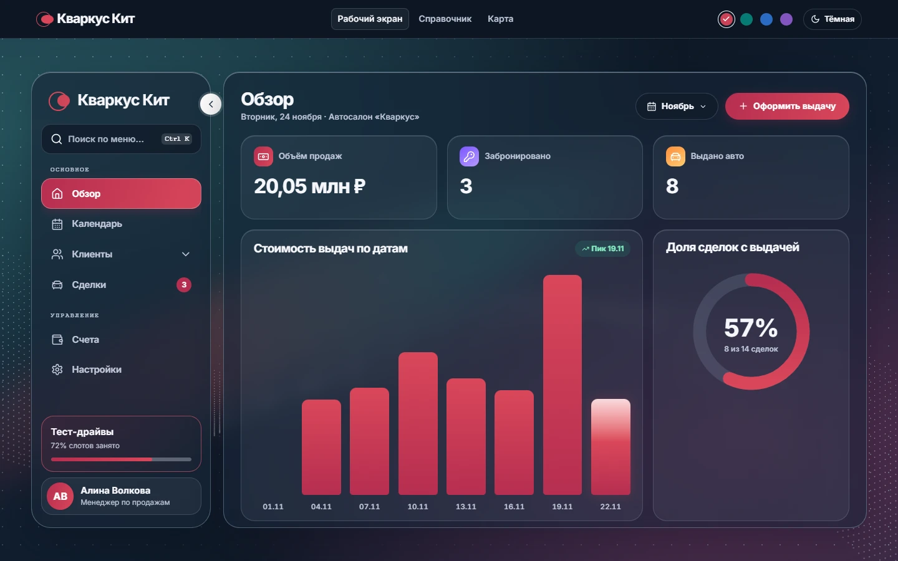
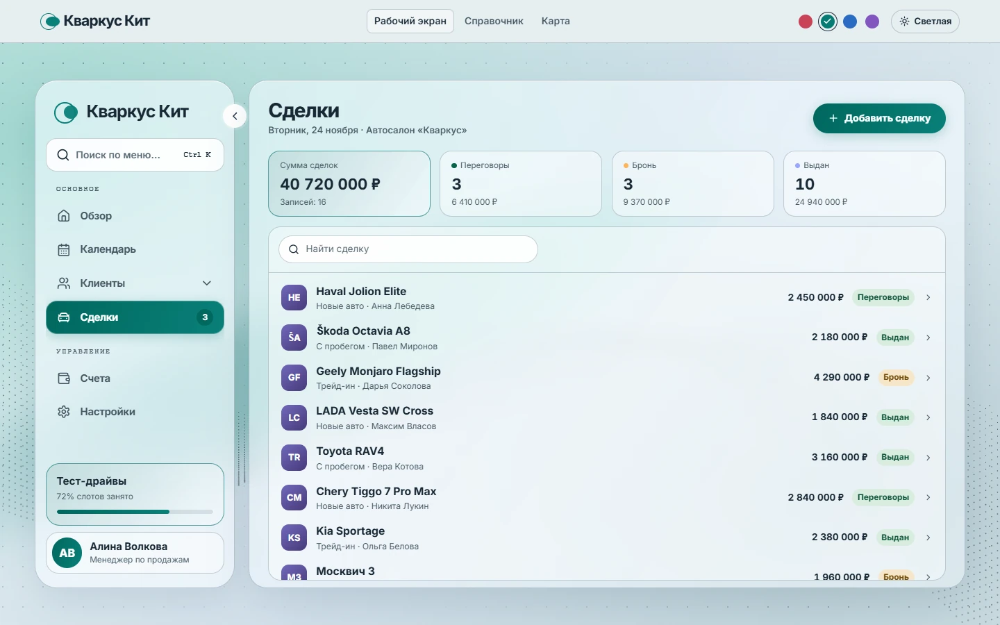
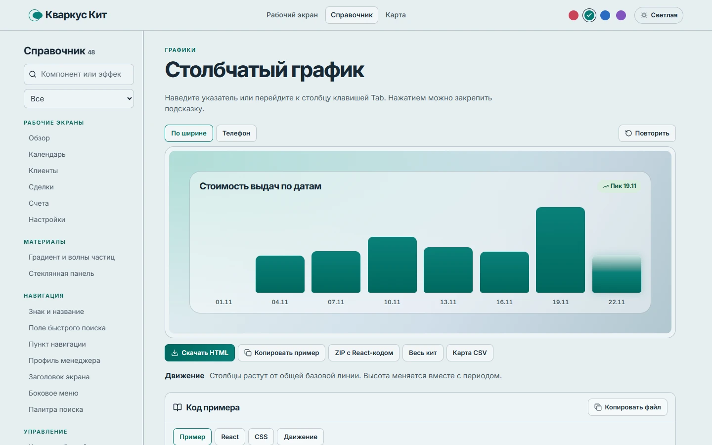
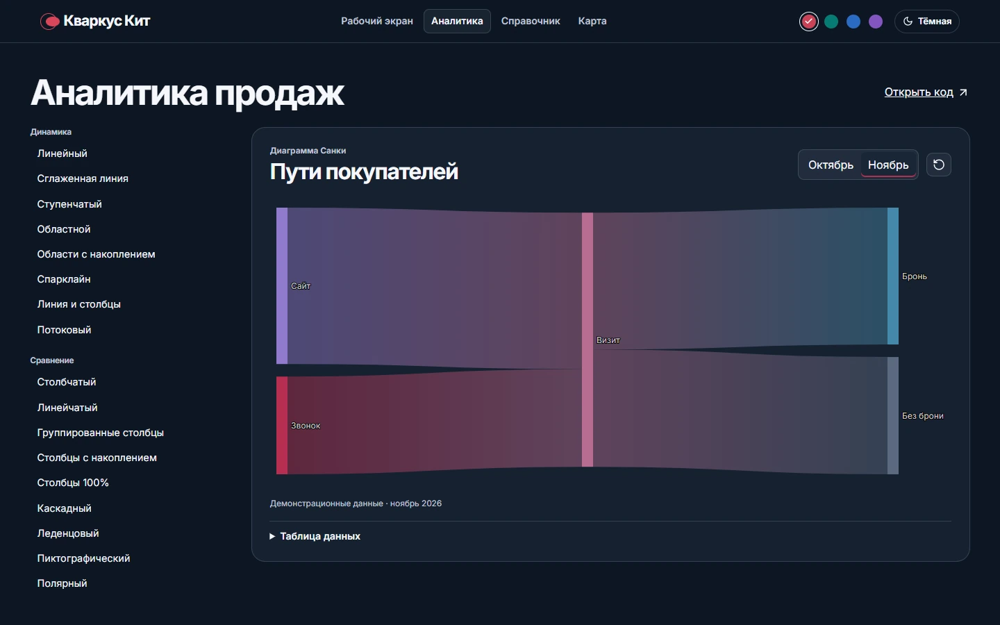

# Кваркус Кит

Интерактивный UI-кит отдела продаж автосалона на React, CSS и JavaScript. В демо «Кваркус» можно найти покупателя по модели автомобиля, забронировать машину, оформить выдачу и отметить оплату счёта. Обзор пересчитывает объём продаж по стоимости выданных автомобилей за выбранный период.

[Открыть демо](https://marketing.parkskazka.ru/kvarkus-kit/) · [Справочник компонентов](https://marketing.parkskazka.ru/kvarkus-kit/guide.html) · [Скачать исходники ZIP](https://marketing.parkskazka.ru/kvarkus-kit/downloads/kvarkus-kit.zip)



## Экраны

| Раздел | Что можно сделать |
| --- | --- |
| Обзор | Выбрать период, посмотреть объём выдач в рублях, количество броней и долю сделок с выдачей |
| Календарь | Запланировать тест-драйв, оценку трейд-ин или выдачу, перенести срок и отметить выполнение |
| Клиенты | Найти покупателя, указать интересующую модель и бюджет, отфильтровать клиентов по сегменту |
| Сделки | Добавить автомобиль и покупателя, изменить цену, перевести сделку из переговоров в бронь или выдачу |
| Счета | Выставить счёт за покупку или бронирование, отметить оплату |
| Настройки | Изменить данные автосалона, роли сотрудников и параметры уведомлений |



## Справочник

В справочнике 91 живой пример. Среди них шесть рабочих экранов, графики, формы, навигация, материалы, токены и анимации. У примера есть предпросмотр на двух ширинах, исходники React и CSS, описание движения и выгрузка отдельным проектом или автономным HTML. Доступны две темы и четыре цветовых акцента.



## Аналитика и загрузка

[Витрина диаграмм](https://marketing.parkskazka.ru/kvarkus-kit/#charts/ChartLine) содержит 42 вида графиков на Apache ECharts. Выберите график, сравните два демонстрационных месяца или откройте таблицу значений. Наборы аналитической витрины иллюстрируют способы визуализации. Рабочий обзор пересчитывается по сделкам текущего браузера.



При загрузке раздела, формы или предпросмотра React показывает макет будущего содержимого до готовности модуля. [В справочнике](https://marketing.parkskazka.ru/kvarkus-kit/guide.html#kit/SkeletonStates) можно посмотреть 19 таких макетов. При системном уменьшении движения макеты и графики отображаются статично.

## Локальный запуск

Понадобятся Node.js 22.12+ и npm.

```sh
npm ci
npm run dev
```

Для статической сборки выполните `npm run build`. Каталог `dist/` содержит рабочий экран, справочник и архивы примеров. Проверить сборку локально можно командой `npm run preview`.

## Данные

Покупатели, сделки, цены и бронирования вымышлены. Демо открывается на 24 ноября 2026 года. Изменения в рабочем интерфейсе сохраняются в localStorage текущего браузера. Отправка уведомлений, платежи и интеграция с CRM в демо не подключены. Полные экраны в справочнике используют отдельные демонстрационные данные.

## Материалы

Фон составлен из CSS-градиентов и волны частиц на Canvas. Диаграммы используют Apache ECharts (Apache-2.0) и ZRender (BSD-3-Clause). Интерфейс использует шрифт Inter (OFL), иконки Lucide (ISC) и React (MIT). Скриншоты сняты с работающего приложения. В разделе «Карта» доступны переходы от автомобильных экранов к коду и архив замеров исходного [композиционного референса](https://nuviocyber.com/demo/physio-clinic-portal/).
